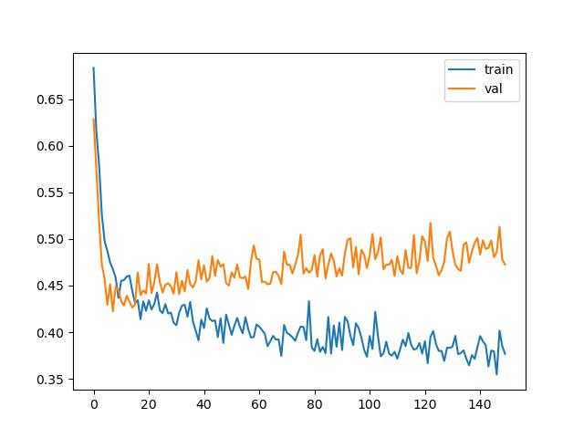
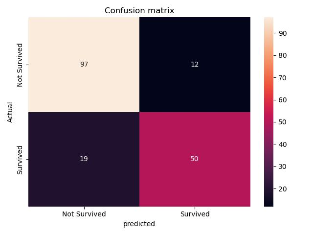

# Titanic Survival Prediction Using Artificial Neural Network (PyTorch)

## Project Overview

This project predicts whether a passenger survived the Titanic disaster using an Artificial Neural Network (ANN) built with PyTorch.

The project demonstrates a complete machine learning workflow including:

- Data preprocessing
- Missing value handling
- Feature encoding
- Feature scaling
- Train-test splitting
- Neural network implementation with PyTorch
- Model training and validation
- Performance evaluation using multiple metrics
- Visualization of learning curves and confusion matrix

---

## Dataset

The project uses the famous Titanic dataset containing passenger information such as:

- Passenger Class (Pclass)
- Sex
- Age
- Fare
- Number of Siblings/Spouses (SibSp)
- Number of Parents/Children (Parch)
- Embarked Location

### Target Variable

- `0` → Did Not Survive
- `1` → Survived

---

## Technologies Used

- Python
- Pandas
- NumPy
- Scikit-Learn
- PyTorch
- Matplotlib
- Seaborn
- Jupyter Notebook

---

## Project Workflow

### 1. Data Preprocessing

- Removed rows with missing Embarked values
- Filled missing Age values using mean imputation
- Applied Label Encoding for categorical features
- Applied One-Hot Encoding for Embarked column
- Standardized features using StandardScaler

### 2. Train-Test Split

- Training Data: 80%
- Testing Data: 20%

### 3. ANN Architecture

```text
Input Layer

↓ Linear (32 Neurons)
↓ ReLU
↓ Dropout (0.3)

↓ Linear (16 Neurons)
↓ ReLU
↓ Dropout (0.2)

↓ Output Layer (2 Neurons)
```

### 4. Training Configuration

- Loss Function: CrossEntropyLoss
- Optimizer: Adam
- Learning Rate: 0.001
- Epochs: 150
- Weight Decay: 1e-3
- Batch Size: 32

---

## Model Performance

### Accuracy

```text
82.58%
```

### Classification Report

```text
              precision    recall  f1-score

Not Survived     0.84       0.89      0.86
Survived         0.81       0.72      0.76

Accuracy                              0.83
Macro Avg         0.82       0.81      0.81
Weighted Avg      0.82       0.83      0.82
```

---

## Visualizations

### Learning Curve

Tracks training loss and validation loss across epochs.



### Confusion Matrix

Provides a detailed view of correct and incorrect predictions.



---

## Project Structure

```text
titanic-ann-pytorch/
│
├── ANN_titanic.ipynb
├── Titanic-Dataset.csv
├── requirements.txt
├── README.md
│
├── images/
│   ├── learning_curve.png
│   └── Confusion_matrix.png
│
└── .gitignore
```

---

## Key Learnings

Through this project, I learned:

- Data preprocessing techniques
- Handling missing values
- Feature encoding
- Feature scaling
- Building custom neural networks using PyTorch
- Model evaluation using multiple metrics
- Visualizing model performance
- Preventing overfitting using Dropout and Weight Decay

---

## Results

The ANN achieved an accuracy of approximately **82.6%** on the test dataset, demonstrating the effectiveness of deep learning on structured tabular data.

### Star the repository if you found it useful.
